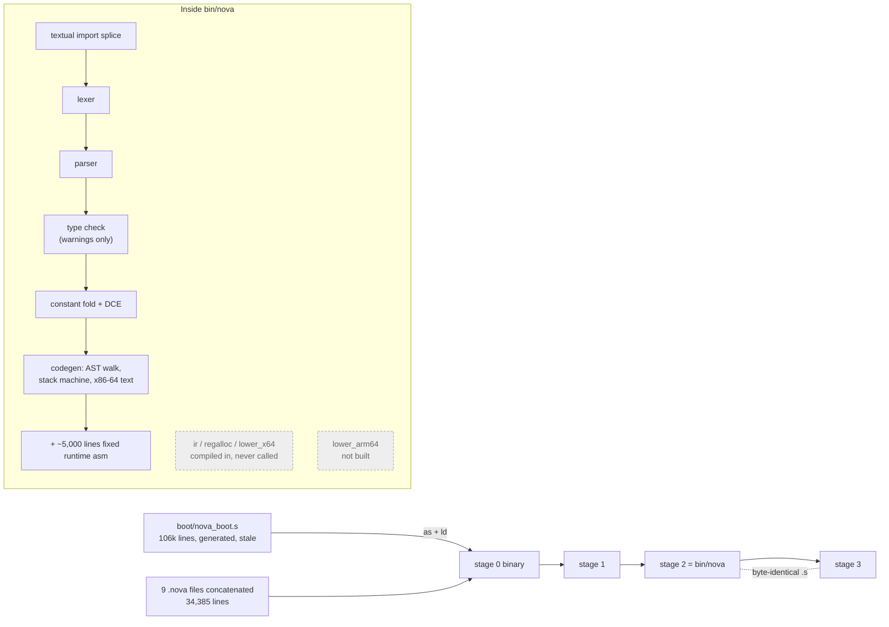
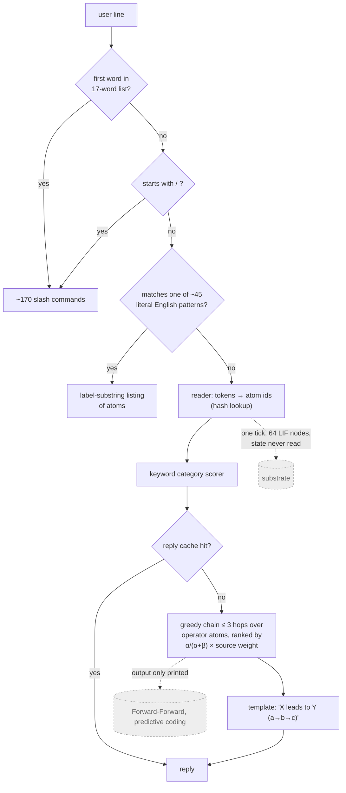
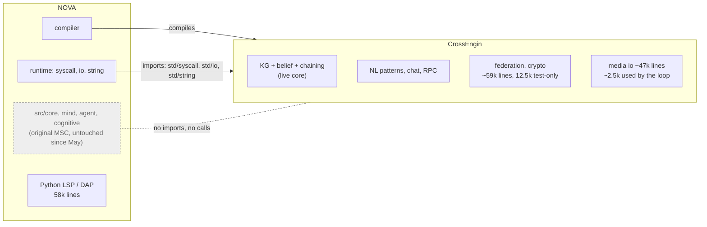

# Moment-Signal Computing — Technical Due Diligence Report

**Subjects:** `amoufaq5/NOVA` at `663bf0e` and `amoufaq5/Crossengin-demo` ("CE") at `78a1dc7`, branch `claude/loving-pasteur-5sndgr`. 
**Audit date:** 2026-11-15. **Method:** read-only review of all 2,009 tracked files (424 read in full, 1,585 skimmed or script-classified — see §11), full git history (329 + 749 commits), builds, test runs and about 200 probe programs in scratch copies. 
**Labels:** CONFIRMED = verified in code or by execution; LIKELY; SUSPECTED. 
**Paths:** `NOVA/…` and `CE/…` are repo-relative. Supporting detail for every section is in `audit/parts/*_findings.md`.

**Baseline caveat.** The founder's statement of the original vision was not supplied (the brief still contained the placeholder). Drift is measured against the earliest commits and documents.

---

## 1. Executive summary

**What it is.** Two repositories, written almost entirely by an AI coding agent over six months (1,027 of 1,078 commits). NOVA is a dynamically typed language whose compiler is written in NOVA, emits x86-64 assembly, and reproduces itself byte-for-byte. CrossEngin is 188k lines of NOVA whose functioning core is a provenance-tracking knowledge graph: each fact ("atom") carries Beta-distribution pseudo-counts (α, β) and source labels, and questions are answered by a greedy walk of at most three hops over stored single-premise rules, rendered through string templates. Input is routed by ~170 slash-commands, ~45 literal English sentence patterns and a keyword classifier.

**Novelty.** "Moment-Signal Computing/Cognition" has had three unrelated definitions in six months. The current official one (CE ADR-0100, August 2026, self-described as "Zero code changes") reduces to Beta-Bernoulli evidence counting on a semantic network with provenance, plus forward chaining. Each element is established prior art; the combination is reasonable engineering, not a new computing paradigm. The spiking-network "substrate" that earlier carried the name is a standard leaky-integrate-and-fire model with Hebbian/STDP rules; it is instantiated with 64 nodes and is inert on the live path.

**Maturity.** Research prototype. The compiler bootstraps but miscompiles many documented features. CrossEngin builds cleanly and has a substantial honest unit-test suite, but no benchmark measures task performance against any baseline, and the only "vs LLM" comparison uses hand-written LLM answers.

**Top five risks**
1. **No evidence for the central claim.** There is no experiment showing MSC does anything a simple graph search cannot; the learning layers named in the docs do not affect answers. (F-01, F-02, F-03)
2. **The test signal is unreliable.** NOVA's `assert` never fires; 71% of NOVA's runner tests cannot fail; neither repo runs its tests in CI. (F-04, F-05, F-06)
3. **Cryptography is unusable.** The OS random call always fails due to a compiler bug; the fallback has 15 bits of entropy. All self-generated keys are guessable. DP and secure aggregation provide no privacy. (F-07, F-08, F-09)
4. **Scope has left the mission.** 60% of CE source is networking/crypto and media decoding; ~21k lines are reachable only from tests; NOVA's MSC code has not been touched since May. (F-10, F-11)
5. **Public claims materially exceed the code.** "~6M-node fabric", "zero hallucination", "latency parity", "v1.0 — all 10 phases complete", "no external deps", "handwritten assembly bootstrap", test counts. (§2)

**Verdict.** As an AGI or new-paradigm claim: **not yet a coherent method; where concrete, it reduces to known techniques.** As a narrowed research question (auditable, evidence-weighted knowledge bases with calibrated abstention): **unproven but testable** — cheaply, see §8. The self-hosting compiler is a genuine technical achievement of limited practical value in its current state.

---

## 2. Claims vs. reality

| # | Claim | Where stated | Evidence | Verdict |
|---|---|---|---|---|
| 1 | Compiler is self-hosting; `stage2.s == stage3.s` | NOVA/README.md:18,37 | Reproduced: byte-identical; stage 4 identical modulo embedded path; deterministic over 5 runs | **Verified** |
| 2 | "Bootstrapped from handwritten x86-64 assembly" | NOVA/README.md:56; docs/adr/0002:31 | `boot/nova_boot.s` line 2 is `.file 1 "/tmp/nova_combined.nova"`; 106,045 lines of compiler output; hand-written seed (≤7,379 lines) replaced in `438e798` (23 May). Seed is 75 compiler commits stale | **False as stated** (true historically) |
| 3 | "Zero dependencies. No libc." | NOVA/README.md:5 | Compiled programs make direct syscalls; build needs only `as`/`ld` | **Verified** (for the compiler and plain programs) |
| 4 | "182 tests (176 pass, 6 skip)" | NOVA/README.md:44 | Re-run: 194 total, 157 pass, 30 fail, 7 skip; and passing is exit-code-only with an inert `assert` | **False** |
| 5 | Type system, ownership model, generics | NOVA commit `81868c7`; README feature lists | Annotations parsed and erased (parser.nova:4827-4836); `let x: int = "s"` accepted; no ownership code exists | **False** (README.md:252 admits erasure) |
| 6 | IR, register allocator, x86-64 lowering pipeline | NOVA/README.md:39; ARCHITECTURE.md:57-64 | `ir.nova`, `regalloc.nova`, `lower_x64.nova` compiled in but never called; codegen is an AST-walking stack machine | **False** |
| 7 | Six targets (Linux, Windows, macOS, WASM, ARM64, Win-ARM64) | NOVA/README.md:29,45 | Linux works; WASM runs hello but miscompiles string `+`; Win/macOS assemble, never executed; ARM64 stubs replace unsupported nodes with 0 (codegen.nova:7929) | **Partially true** |
| 8 | Version 4.2.0 | NOVA/README.md:37 | `VERSION` 0.1.0, `src/version.nova` 0.2.0, launcher 0.9.0; no tags, no releases | **Unsupported** |
| 9 | MSC concepts are first-class in the language | NOVA/README.md:50-60 | `mind`/`soul`/`system`/`~>` desugar to library calls (codegen.nova:10224, 10424, 10575, 5501-5517); the two headline examples do not parse | **Partially true** (syntax only) |
| 10 | "Compiler knows the entire signal graph… inlines full pipelines" | NOVA README at `95270d9`:115-117 | No such analysis exists | **False** |
| 11 | CE is "non-LLM"; "no LLM in the reasoning path" | CE/README.md:21-30; docs/VISION.md:45-53 | Default path makes no model call (strace-verified). Opt-in: Ollama/llama-cli/OpenAI-compatible extractor, fallback parser, reply composer (scripts/llm_*.sh; chat:1701-1707, 8212-8224); 2 of 3 hooks currently broken | **Partially true** |
| 12 | No deep learning / transformers | project framing | STT forks `whisper-main -m ggml-tiny.en.bin` or `python3 … vosk` (CE/src/io/…/whisper_backend.nova:72-73,407-427; vosk_backend.nova:204-232) | **False for voice features** |
| 13 | "~6M-node fabric on tick-driven core" | CE/README.md:38; ANALYSIS.md:31 | `CE_CAP = 128`, 8 nodes per part, 8 parts = 64 nodes (chat:151-152,7725). 6M is a planning target in ADR-0003:21 | **False** |
| 14 | "v1.0 — all 10 phases complete" | CE/README.md:54 | Modules exist; the ADR-0049/0050 capability exit tests were never run; many phase modules are test-only | **Unsupported** |
| 15 | Continuous learning; "gets faster the more it's used" | CE/docs/HOW_IT_LEARNS.md; README | Reply memoisation + counters. Tick Hebbian Δw is always 0 live; three-factor flag off; FF and PC outputs unused. Commit `197e614` message admits "zero live callers outside tests" | **Unsupported** |
| 16 | "Hallucination risk: Zero (says 'unknown' instead)" | CE/docs/VISION.md:96,121 | "مرحبا" → "help leads to response"; "is fever good or bad?" → "i think infection leads to headache"; `learn.sh` stores "earth is_a flat" from "the earth is not flat" | **False** |
| 17 | "Latency parity with LLMs is a hard requirement" enforced by harness | CE/docs/VISION.md:55; adr-0208 | `bench/latency_v1/baseline.json` has `"results": []`; harness OOM-killed at 13.6 GB on a 1,000-atom KG; measured p99 1,022 ms vs 500 ms budget | **Unsupported** |
| 18 | "Head-to-head vs recorded LLM: engine 12/12 vs LLM 9/12" | chat `/vs`; CE/data/llm_baseline_sample.txt | LLM verdicts set by an `if` (src/bench/reasoning_bench.nova:356-378); items carry their own proofs (:59-63) | **False** (fabricated baseline) |
| 19 | "No external deps" | CE/docs/VISION.md:97 | curl, python3 shims, openssl, ffmpeg, espeak, whisper, vosk, Ollama, Vercel/Next.js documented elsewhere in the repo | **False** |
| 20 | "All 221 unit tests pass" | CE/README.md:1131 | Stale; current suite is 478 files; this audit's run: see §6.10 | **Stale** |
| 21 | NOVA self-host fixpoint is "a load-bearing CI gate" | CE/README.md (status table); NOVA ADR 0002:47 | Neither repo's CI runs it | **False** |
| 22 | AGI-relevant capability: theory of mind, self-awareness, counterfactual reasoning | CE/README.md:28; ARCHITECTURE.md:28 | Modules are small bookkeeping; `theory_of_mind`, world model, dream/counterfactual imagination are test-only. CE/ENHANCEMENTS_ROADMAP.md:1944-1947: "It does not claim AGI" | **Unsupported** |
| 23 | Mother bakes signed child models that deploy knowledge | CE/docs/VISION.md; adr-0200 | Ed25519 signing real; `#KG v1` section written (factory/bake.nova:114-116) but not among loader markers (sandbox/session_snapshot.nova:892-900) — LIKELY never loaded | **Partially true** |
| 24 | DP + secure aggregation federated learning | CE/README; FEDERATED_AUDIT.md | Federates two integers per source; DP seed is `budget + 7919` (identical noise every run); 15-bit masks | **False in effect** |
| 25 | JPEG/PNG decoders, SHA-256, Ed25519, ECDSA etc. implemented in NOVA | CE README | JPEG within 1 level of Pillow on 5 real files; PNG bit-exact; 28 crypto suites pass incl. official vectors | **Verified** |

---

## 3. Scorecard

| Dimension | Score | Justification |
|---|---:|---|
| Clarity of vision | 3 | Three definitions of MSC; five self-descriptions of CE in six months; vision documents contradict each other on LLM use. |
| Scientific novelty | 2 | Current MSC = Beta-Bernoulli counts on a provenance KG + greedy forward chaining. Sensible combination, no new mechanism. |
| Evidence & rigor | 1 | No task benchmark, no baseline, no held-out data; one fabricated comparison; throughput benches print loop counts. |
| Language design | 3 | Untyped, no block scope, no module system beyond textual splice, 16-slot maps, strings are NUL-terminated bytes. Pleasant surface syntax. |
| Compiler correctness | 3 | Fixpoint holds; but inert `assert`, wrong enum values, broken destructuring, `exit(n)`→2n+1, 10 of 27 sampled builtins wrong, type-confusion segfaults. |
| Self-hosting status | 7 | Real, reproducible, deterministic. Deductions: seed is a stale generated blob; no source-only bootstrap path. |
| Architecture | 4 | The live core is small and coherent; around it, large subsystems accreted without integration; dead pipeline stages documented as live. |
| Security | 2 | No working CSPRNG; unauthenticated listeners; unauthenticated TLS by default; no sandbox; careful process spawning and robust binary parsers are positives. |
| Code quality | 4 | CE modules are readable with candid headers; NOVA codegen is one 24k-line file with an 8,292-line function; pervasive fixed `/tmp` paths. |
| Testing / reproducibility | 3 | CE: 21k genuine assertions. NOVA: mostly inert. No test CI; NOVA unpinned; builds are fast and one-command. |
| Documentation | 3 | Enormous and locally candid; top-level documents are inaccurate and stale; 21 duplicate ADR numbers. |
| **Overall** | **3** | A working bootstrap and an honest small knowledge engine, under claims and scope neither supports. |

---

## 4. Diagrams

### 4a. NOVA compiler pipeline (actual)

### 4b. CrossEngin: what computes a reply

### 4c. How the two repositories connect

---

## 5. Findings table

Effort: S ≤ 2 days, M ≤ 2 weeks, L > 2 weeks. All CONFIRMED unless marked.

| ID | Sev | Category | Title | Location | Evidence | Impact | Fix | Effort |
|---|---|---|---|---|---|---|---|---|
| F-01 | Critical | Research | No task-performance evaluation of MSC exists | CE/tests/benchmark, bench/, src/bench | All benchmarks are latency/throughput or self-built toys; no dataset, baseline or held-out split | Central claim is untested | Run §8 experiments | M |
| F-02 | Critical | Research integrity | "vs LLM" benchmark uses invented LLM verdicts and self-supplied proofs | CE/src/bench/reasoning_bench.nova:59-63,356-378; data/llm_baseline_sample.txt:1-9; chat:2755 | LLM answers assigned by `if`; output headed "vs recorded LLM" | Misleading to any reader or investor | Remove `/vs` or record real transcripts | S |
| F-03 | Critical | Research | Learning layers do not affect behaviour | CE/src/substrate/tick_driver.nova:54-63,96,251; chat:3365,8088-8094 | Hebbian Δw always 0 (snapshot indexed by slot, synapses by atom id); 3-factor off; FF/PC outputs unused; reply byte-identical after 10× `/good` | "Learning" claims unsupported | Wire one mechanism to a measured outcome, or remove claims | M |
| F-04 | Critical | Compiler | `assert()` never fires | NOVA/src/compiler/codegen.nova:19037-19048 | `test rdi,rdi; jnz ok` but tagged false = 1; `assert(1==2,"boom")` continues rc=0 (reproduced by lead) | 1,038 assertions in 72 test files inert | Compare against tagged false | S |
| F-05 | High | Testing | NOVA test runner is exit-code-only; 138/194 tests cannot fail | NOVA/tests/run_tests.sh:361-378 | 60 print-only, 70 inert-assert, 8 always exit 0; with asserts re-enabled 19 of 58 sampled "passing" tests fail | Pass counts meaningless | Golden-output diffs; fix F-04 | M |
| F-06 | High | CI | Neither repo runs tests in CI; NOVA unpinned | NOVA/.github/workflows (release only); CE/.github/workflows/build-and-smoke.yml:27-31,47-84; CE/.devcontainer/setup.sh:25 | CE CI greps five golden counters | Regressions land unnoticed; builds not reproducible | Add `make test`, self-host check; pin NOVA SHA | S |
| F-07 | Critical | Security | `secure_random` always fails on Linux x86-64 | NOVA/src/compiler/codegen.nova:22547-22548, 19515-19535 | `getrandom(0x…001, 65, 0) = -1 EFAULT` (strace, reproduced by lead): pointer and length passed tagged | No OS entropy anywhere | Untag args | S |
| F-08 | Critical | Security | Fallback RNG is a 15-bit LCG seeded from `nanotime & 32767` | CE/src/safety/ed25519.nova:1161-1181; p256.nova:747-764; io/transducers/noise_xk.nova:440-455; sandbox/capability.nova:804-822; federation/dtls12.nova:1992 | Generated Ed25519 seed recovered by trying 32,767 values; ECDSA nonces from same source | All keys, tokens, nonces guessable; signature keys recoverable | Fail closed when CSPRNG unavailable; regenerate all keys | S |
| F-09 | Critical | Security | DP noise deterministic; SecAgg masks 15-bit and reused | CE/src/safety/differential_privacy.nova:189,446-454; learning/secure_aggregation.nova:420-449,495-520 | Two fresh states give identical noise; noise shrinks below ε=0.01 | No privacy guarantee | Remove feature or rebuild on a real CSPRNG | M |
| F-10 | High | Drift | 60% of CE source is off-mission; 56 files / 21k lines test-only | reachability script (`audit/parts/ce_surface_findings.md`) | WebRTC/ICE/STUN/TURN/SRTP/NAT/Raft, planner, autonomous agent, theory of mind imported only by tests | Maintenance cost; obscures the core | Move to an archive branch | S |
| F-11 | High | Drift | NOVA's MSC libraries are orphaned | NOVA/src/core, mind, agent, cognitive; CE imports | 16 commits, all May; CE imports only std/syscall, std/io, std/string, std/node_pool | The "language for MSC" does not serve MSC | Decide: delete or re-adopt | S |
| F-12 | High | Compiler | Many documented features miscompile | probes in `audit/parts/nova_compiler_findings.md`, `nova_tools_tests_docs_findings.md` | enum variants 0,0,1,1; `let [a,b]=[7,9]` → 7,7; `float_to_str` halves integer part; `exit(n)` → 2n+1; `sum([1,2,3,4])`=12; 17th map key hangs; undefined variable reads stack garbage; `-7/2` = -4 vs -3 | Silent wrong results | Conformance suite; finish tagging rework | L |
| F-13 | High | Compiler | No memory or type safety | NOVA/src/compiler/codegen.nova:6396-6410,16931,16947,17051 | No bounds check on list/string writes; `"a"+5` is pointer arithmetic; bump allocator never frees | Crashes, corruption; 13.6 GB RSS on small workloads | Bounds checks; arena reset | M |
| F-14 | High | Bootstrap | Seed is a stale generated blob | NOVA/boot/nova_boot.s:1-2; Makefile:23-45 | 304 of 479 current compiler functions; needs `setarch -R` workaround; not reviewable | Trusting-trust exposure; fragile rebuild | Regenerate seed per release; keep a reviewable stage-0 | M |
| F-15 | High | Supply chain | Install and Homebrew URLs point to `nova-lang/*`, not the origin repo | NOVA/packaging/homebrew/README.md:15-32; bump-formula.sh:44; install.sh | Origin is `amoufaq5/NOVA`; no checksum verification; placeholder sha256 | Whoever owns that org controls installs | Point to the real repo; verify checksums | S |
| F-16 | High | Security | Network listeners unauthenticated by default | CE/src/federation/gossip.nova:1201-1300; examples/crossengin_rpc_daemon.nova:150-159; src/nl/rpc_verbs.nova:3761-3819 | Gossip peers can dump/inject atoms; RPC token opt-in; `admin.bake_child` takes arbitrary paths | Remote read/write if bound off loopback | Auth on by default | M |
| F-17 | High | Security | TLS 1.3 client unauthenticated by default; X.509 lacks CA checks | CE/src/io/transducers/tls13_client.nova:259-273,712-721; safety/x509_verify.nova:396-437 | Strict mode only with `CE_TLS_STRICT`; server Finished never compared | MITM on all fetches | Verify by default | M |
| F-18 | High | Security | Web surfaces: public relay, no CSRF protection, session leak | CE/infra/vercel-proxy/web/app/api/chat/route.ts:53-105; scripts/web.py:1003,1088-1117 | Unauthenticated relay incl. slash commands; `/api/sessions` returns cookie values | Remote command execution of chat verbs | Auth + Origin checks | S |
| F-19 | High | Security | Internet fetch without approval; `/rss` reads `file://` and private IPs | CE/examples/crossengin_chat.nova:7475,7517,7590; src/io/…/kg_rss_ingest.nova:677-748 | Observed during audit: `/research` contacted Wikipedia with no prompt | SSRF, local file read, KG poisoning | Gate all fetch paths | S |
| F-20 | High | Correctness | `learn.sh` inverts negations | CE/scripts/learn.sh:320-323,369-374 | "The earth is not flat" → `earth\|is_a\|flat` (executed) | Stores false facts with confidence | Drop `not` bridging | S |
| F-21 | High | Performance | Memory blow-up | CE scripts/bench_nl_verbs.sh; substrate benchmark | OOM at 13.6 GB on 1,000-atom KG; 405 MB for 420k node-ticks | Cannot scale | Allocation discipline | L |
| F-22 | High | NL | Grammar layer shadows better handlers; auto-prefix hijacks sentences | CE/examples/crossengin_chat.nova:3513-3554; src/nl/grammar_parser.nova:1300-1433 | "what is 17 * 23" fails by default, works with `CE_NL_OFF=1`; "good morning" runs `/good` | Poor default behaviour | Reorder dispatch | S |
| F-23 | High | Feature | Baked child bundle KG never loaded (LIKELY) | CE/src/factory/bake.nova:114-116; sandbox/session_snapshot.nova:892-900 | Marker not recognised by loader | Core "factory" feature non-functional | Add marker + round-trip test | S |
| F-24 | Medium | Security | Fixed `/tmp` paths; unsigned snapshot sections | CE/examples/crossengin_daemon.nova:525; src/persistence/snapshot_disk.nova:2710-2735,2897-2912 | Daemon reads commands from `/tmp/crossengin_input`; snapshot 0644, no O_EXCL; malformed count kills loader | Local privilege/tamper | Per-user dirs; sign whole file | M |
| F-25 | Medium | Security | Input-line smuggling; no OS sandbox; "safety" is one substring | CE chat line reader; chat:6153; parts/soul/constitution.nova:100-112 | 1023×"a"+"/status" executes `/status`; rule is case-sensitive `"exfiltrate"` | Safety claims overstated | Reject over-long lines; rename | S |
| F-26 | Medium | Benchmarks | Throughput benches print iteration counts; one does not compile | CE/tests/benchmark/bench_node_throughput.nova etc.; Makefile:206-211 | 1-second clock, `safe_div` returns numerator; exit codes discarded | Numbers meaningless | Fix clock; fail on error | S |
| F-27 | Medium | Tooling | LSP diagnostics dead; docs name pygls which is unused | NOVA/tools/nova-lsp/nova_lsp/server.py:425-431 | Regex expects `file:line:col:`; compiler prints `error[line N]:` | Editor shows no errors | Align formats | S |
| F-28 | Medium | Docs | Version, LOC and test counts inconsistent; 21 duplicate ADR numbers; no formal grammar | NOVA README vs VERSION; CE docs/adr | See §2 | Loss of trust | Single source of truth | S |
| F-29 | Medium | Legal | NOVA has no licence; CE is "Proprietary and Confidential" but cloned anonymously | NOVA root; CE/LICENSE; CE/.devcontainer | README.md:1205 says "See LICENSE" | Unclear rights | Add licence; check visibility | S |
| F-30 | Medium | Hygiene | 13 MB core dump in git history | CE history, blob `core` (removed `e538f79`) | Process memory image | Possible data exposure; bloat | History rewrite if public | S |
| F-31 | Medium | Regression | `float_cmp` wrong; db reload loses records; `make agent` broken; `make test` fails | NOVA runtime; Makefile:599,621-631 | 0.65 vs 0.35 → 0; save 3 load 0 | NOVA cognitive demos broken | Fix + tests | M |
| F-32 | Low | Naming | Names overstate function throughout | e.g. NOVA imagination.nova:48-60; CE COWORK, CODING_REVIEWER, MCP | "Imagination" = 10-row keyword table + `random()`; "1000+ causal patterns" = 51×19 | Misleads the founder and readers | Rename to what code does | M |
| F-33 | Low | Dead code | 2,139 dead compiler lines; dead LLM/BLAS/GPU/Python bridges in NOVA | NOVA/src/compiler/ir.nova etc.; src/runtime/llm.nova, blas.nova, python.nova | Zero callers | Confusion | Delete | S |

No secrets (API keys, private keys, provider tokens) were found in either working tree or in full history (regex scan over `git log -p --all`). Only development placeholders such as `local-dev-token`.

---

## 6. Detailed findings by area

### 6.1 What MSC computes (Phase 5 — definition from code)

**Definition 1 — NOVA, May 2026** (`NOVA/src/core`, `src/mind`). 
- *Moment*: 9-slot record of a string and 0–100 integers; urgency is the constant 50 (moment.nova:82-95). 
- *Signal*: envelope `[type 1..22, dest, priority, trace]` (signal.nova:45-56). 
- *Node*: mailbox + state map + one of six hand-written handlers (node.nova:672-690). 
- *Scheduler*: pop highest priority, look up node by name, drop if already in trace, forward outputs along channels (scheduler.nova:128-169). 
- *Similarity*: `0.35·s₁ + 0.20·s₂ + 0.15·s₃ + 0.15·s₄ + 0.10·s₅ + 0.05·s₆` over string-equality scores (similarity.nova:19-29). 
No vectors, no floats, no learning rule on the runnable path. This is an actor/blackboard message-passing framework. The shipped agent does not use it: `agent.nova:157-216` is ~35 substring rules over a triple store.

**Definition 2 — CE substrate, May 2026** (`CE/src/substrate`). Fixed-point (×1000) integers. 
- Node: `a' = clamp(0.9·a + inbox + bias, 0, 4)`; fire and reset if `a' ≥ θ` (default 0.5). 
- Propagation: for each fired node *i*, `inbox[post(s)] += w_s`. 
- Plasticity: `Δw = m·(0.02·pre·post + 0.03·pre·err)`; eligibility decays ×0.9. 
- Optional three-factor: triangular STDP kernel over 20 ticks; `w += 0.04·nm·elig`. 
This is a discrete leaky-integrate-and-fire spiking network with Hebbian, delta-rule and reward-modulated STDP learning. Implemented, unit-tested, **inert**: 64 nodes live, snapshot/synapse index mismatch makes Δw = 0, the three-factor flag is never enabled, and no reply code reads node state.

**Definition 3 — CE ADR-0100, August 2026 (current)**. 
- Node = KG atom `[id, kg, kind, label, payload, (α, β), embed, xrefs, provenance, …]`. 
- Signal = `bel_observe`: `α += g` or `β += g`, g = 1 or 0.25–1.0 by evidence grade (atom_store.nova:70-90; verified by lead). Confidence = α/(α+β), prior (1,1). Formal proofs pin (999, 1). Decay: `x ← 1 + 0.99·(x−1)` every 64 ticks. 
- Moment = appended record `{id, ts, modality, text, salience, origin, trace ids}`. 
- Attribution = provenance tuple + `src:` label prefixes. 
- Inference: greedy path, depth ≤ 3; `score(op) = conf(op) · src_weight · (1 + w_syn)`; reply = template. 
- Feedback: `/good` / `/bad` → `α or β += 1`, `w_syn ±= 0.1`.

ADR-0100:28-38,138 states this was "a documentation gap, not a code gap… Zero code changes", and it cites the wrong file for moments.

**Does it learn?** Three modest, real mechanisms: (a) fact and word storage via explicit commands and five hand-written text patterns; (b) Beta counters; (c) ±0.1 edge weights from explicit feedback. After 6× `/bad` the chosen chain changed. No gradient-based learning anywhere. No generalisation: nothing learned about one edge transfers to another. The only before/after improvement test in the repo is tabular Q-learning on a 5×5 grid, test-only.

**Hand-coded vs acquired.** Default boot: 584 atoms = 542 words + 42 hand-typed relations. The demonstration answer for "fever" is `first_atoms.nova:328-333`. Seven optional packs: 324 atoms, 347 implications, hand-format. After loading `biology.cerec`, "does photosynthesis produce oxygen" → "i don't have a model of 'photosynthesis'".

**Scaling.** Label lookup O(n/256) with a 15-bit hash; reply cache O(entries × 10,000); HDC vectors ≥ 80 KB each; belief decay and consolidation O(atoms) scans; lists never shrink; the allocator never frees. Observed: 405 MB for 420k node-ticks; OOM at 13.6 GB on a 1,000-atom latency bench. A 6M-node tick would take ~10 s (LIKELY, extrapolated).

**Verdict.** *Not yet a coherent method* as a paradigm (three definitions, the live one chosen retroactively); *reduces to known techniques* where concrete; *unproven but testable* if narrowed to evidence-weighted, provenance-carrying KBs with abstention.

### 6.2 Evidence inventory

| Item | What it tests | Baseline | Reproducible | Result on re-run |
|---|---|---|---|---|
| CI "fever smoke" | Five exact counters after typing "fever" + `/good` ×10 | none | yes | Reproduced exactly; counters are cache hits, clamp-saturated values and button-press counts |
| `/vs`, `reasoning_bench` | 12 items with supplied proofs vs hard-coded LLM | fabricated | yes | 12/12 vs 9/12 by construction |
| `bench_node_throughput`, `bench_tick_rate`, `bench_kg_query` | throughput | none | yes | Print iteration counts (1-s clock) |
| `bench_predictive_coding` | — | — | no | Does not compile |
| `bench_nl_verbs` (ADR-0208) | latency | empty baseline file | no | OOM-killed; p99 1,022 ms vs 500 ms budget |
| operator lookup / ANN / KG index speedups | indexed vs linear scan | own naive version | noisy | 1901× vs ~1132× documented; 79× vs 40× |
| BENCHMARKS.md SIMD | SIMD vs Nova scalar | own scalar | partly | 6.21× (claimed 5.94), 91× (107), 1.13–1.24× (3.35); HOG bench does not compile |
| `self_improve` | Q-learning on gridworld | none | yes | return −200 → 93; test-only |
| CE unit suite | component correctness | hand-derived expectations | yes | see §6.10 |

No experiment in either repository bears on whether MSC has an advantage on any task.

### 6.3 The language and compiler (Phase 6)

**Self-hosting: CONFIRMED.** 100% of the compiler is NOVA (34,637 lines). Bootstrap path: committed generated assembly seed → stage 1 → stage 2 (`bin/nova`) → stage 3; stage 2 and 3 assembly are byte-identical; stage 4 differs only in the embedded source path. Build takes 1.6 s. Weaknesses: the seed is not human-written or reviewable, is stale, and carries an old pointer-classification bug that requires an ASLR workaround (Makefile:23-45).

**Design.** No formal grammar (the original EBNF was deleted in `dfa5a2f`). Dynamically typed: 63-bit tagged integers (`2n+1`), raw pointers, floats tracked by variable name. Annotations and generics are parsed and discarded; `id<int>(5)` misparses as a comparison. No block scope; a local `let x` overwrites a global `x`. Modules are textual splices. Strings are NUL-terminated bytes — `len("مرحبا")` is 10; no Unicode awareness. Maps have 16 fixed slots. Error handling is try/catch sugar. Concurrency is cooperative coroutines. FFI via `extern fn`, inline `asm`, `ffi_*`. Bump allocator, no GC, no free. `fn main()` is not called automatically.

**MSC in the language.** `mind`, `soul`, `system` and seven flow operators are parser-level sugar for calls into `src/core` library functions. NOVA is a general-purpose scripting language with MSC as an (orphaned) library.

**Optimisations actually run:** literal constant folding, unused pure `let` removal, identity peepholes, divide-by-power-of-two shift (buggy for negatives), self tail-call to jump.

**Probe results (selection; ~75 probes total).** `assert(false)` continues. Enum variants `0,0,1,1`. `let [a,b]=[7,9]` → `7,7`. `exit(4)` → status 9. `float_to_str(3.14)` → `1.140000`. `sum([1,2,3,4])` = 12; `hex(255)` = `0x1ff`. 17th map key hangs. Undefined variable prints stack garbage. `"a" + 5` prints another string's bytes. Integer literals ≥ 2⁶¹ wrap silently. Unterminated strings compile. 10,000 nested parentheses segfault the compiler. Deep non-tail recursion is a bare SIGSEGV. Positive: 5M-deep tail recursion works; large-literal arithmetic is correct at HEAD.

**Tooling.** LSP and DAP (stdlib Python) are real; all 43 of their test scripts pass; the debugger works end-to-end through gdb. LSP diagnostics are dead (F-27). Tree-sitter grammar passes 150/150 and parses 97% of both repos. No REPL, no formatter. `nova pkg` edits a local manifest only. Syntax is hand-described in four places.

**Is the language an asset on its own?** As a demonstration and teaching artefact, yes. As a tool for others, not in its current state: silent wrong results, no types, no licence, no release.

### 6.4 Architecture (Phase 7)

The live CE architecture is small: reader → classifier → chain → template, over an atom store. It is coherent. Around it: (a) a substrate that ticks but is not consulted; (b) learning modules whose outputs are printed; (c) a 59k-line networking/crypto stack of which 12.5k lines are test-only and DTLS runs over TCP with a non-standard shim; (d) a 47k-line media stack of which ~2.5k lines serve the loop and whose outputs never reach the KG (CE/IMAGE_AUDIT.md:632-635 says atom creation "is a separate follow-up"). Coupling between these islands is low, which makes pruning easy. The architecture no longer matches any single version of the vision; it has accreted around several.

### 6.5 Security (Phase 8)

Covered by F-07 to F-09, F-15 to F-19, F-24, F-25. Additional points:
- **Code execution.** The system cannot write and execute code. "code_exec" is an arithmetic evaluator; skills are three compiled-in functions; `self_improve` is a gridworld learner. NOVA programs themselves are unsandboxed (inline asm, `system_exec`, `fork_process`, sockets).
- **Process spawning** is done with `execve` and argv; three injection attempts failed. Good practice.
- **Binary parsers are robust:** 2,000 mutated JPEG/PNG/Y4M/WAV/PGM inputs, zero crashes or hangs.
- **Crypto primitives are correct** against official vectors (28 suites), but there is no interop test against OpenSSL, and correctness is moot without entropy.
- `test_rng` prints SKIP for the OS backend and still reports OK.
- "Capability tokens" are bearer strings in a list, off by default.

### 6.6 Code quality (Phase 9)

- **NOVA:** `codegen.nova` is 24,119 lines; `gen_runtime` is one 8,292-line function; 35% of lines are `out("asm")`; 91 target comparisons; symbol "hash" is `len(name) % 8`, making a 45,000-global file take 24.8 s. Riskiest functions are listed in `audit/parts/nova_compiler_findings.md`.
- **CE:** consistent module style, descriptive headers that often state scope honestly, almost no TODO markers (1) but 69 "honest scope / deferred / placeholder" comments. List-of-lists records indexed by named constants stand in for structs. Fixed `/tmp` filenames in the Makefile, 39 unit tests and 109 integration scripts. `examples/crossengin_chat.nova` is an 8,000+-line entry point.
- **Naming** systematically overstates (F-32).
- **Eras are visible:** five ADR numbering schemes, at least eight "phase" series, round numbers that restart.

### 6.7 Testing and operations (Phase 10)

- **NOVA:** F-04, F-05. `tests/unit/` (658 checks, cited in the README) is run by nothing; 7 of 10 fail by hand. No coverage measurement.
- **CE:** 478 unit files, 21,340 assertions, median 34 per file, none empty; 78% compare against literals; hand-read sample shows genuine small-fixture tests. Weaknesses: 96 files have skip-as-pass paths; 16 files assert stub behaviour; the four thinnest tests are the cognitive-loop ones (2–3 assertions); "coverage" is import reachability and currently fails (385/397); `make lint-ints` fails.
- **Build from clean checkout:** works in one command for both repos given `as`/`ld`. NOVA is unpinned.
- **Bus factor:** one human, with an AI agent as sole author; the 8,930-line `NEXT_SESSION.md` hand-off log is the institutional memory and is frozen at 3 August in CE.

### 6.8 Drift (Phase 3)

See `WHERE_WE_ARE.md` §3 for the dated timeline. Quantified:
- NOVA: commits touching MSC libraries — 16 (May only). Compiler — 175. Tooling — 53. June added 68,217 lines of Python tooling and 0 lines of MSC.
- CE: lines added by area — tests 165,735; docs 117,411; net/crypto/infra 66,809; media 48,922; cognition core 42,715; NL/agent/chat 34,298. 102,774 source lines landed 29 May–5 June.
- Process: 26 "rounds" with ~156 parallel agent dispatches in ~10 days (CE/RETROSPECTIVE_26_ROUNDS.md:3-4). Scope grew through a caveat→follow-up loop: each round's listed limitations became the next round's work. CE/docs/session_log/archive.md:18325 records "What remains is depth, not breadth" immediately before the breadth sprint.
- The no-LLM line eroded in dated steps: ADR-0013/0014 reject any LLM use → Whisper subprocess (`0874516`, 1 June) → Ollama/OpenAI extractor (`59ba707`, 3 Aug) → LLM fallback parser (`d0961eb`, 7 Aug) → Ollama reply composer (`197e614`, 9 Nov). The CI guard specified in ADR-0014 (`tests/no_llm_cognition.nova`) does not exist.

**Centre of gravity today:** infrastructure. By LOC and by commits, most effort is in tests, documentation, networking/crypto and media decoding; in NOVA, in the compiler and editor tooling. The MSC model is the smallest part.

### 6.9 Reality table (Phase 4)

| Component | Claimed | Actual | Evidence |
|---|---|---|---|
| NOVA compiler (Linux x86-64) | production | **Partial** | self-hosts; many miscompilations |
| IR / regalloc / lowering | pipeline stages | **Dead** | never called |
| ARM64 backend | target | **Stub** | codegen.nova:7929 |
| NOVA src/core + mind | MSC foundation | **Dead** (unused by CE) | import graph |
| NOVA agent | cognitive agent | **Partial** | keyword bot; `make agent` broken |
| NOVA LLM / BLAS / Python / GPU bridges | integrations | **Dead** | zero callers |
| CE atom store + belief + provenance | KG | **Working** | tests + live |
| CE chain reasoning | reasoning | **Working** (≤3 hops, single-premise) | cognitive_router.nova:155-246 |
| CE proof kernel | formal verification | **Working** (small) | mind/verify.nova |
| CE substrate | fabric | **Working in tests, inert live** | tick_driver.nova |
| Forward-Forward, predictive coding | learning | **Partial**, output unused | chat:3365, 8088-8094 |
| Theory of mind, world model, dreams, planner, autonomous agent | cognition | **Dead** (test-only) | reachability |
| NL grammar | LLM-free NLP | **Partial** | ~45 literal patterns |
| HDC | embeddings | **Partial** | vectors seeded from spelling; bind/permute unused |
| LLM sidecar / composer | fallback | **Partial**, 2 of 3 broken | nl_llm_sidecar.nova:284-291 |
| `/vs` LLM comparison | benchmark | **Fake** | reasoning_bench.nova:356-378 |
| STT | voice | **Mock** over Whisper/Vosk | stt_seam.nova:99,151-160 |
| Face detection, OCR, object detection, speaker ID | perception | **Stub** on real data | image_face_detect.nova:10-19 etc. |
| JPEG / PNG decoders | codecs | **Working** | ground-truth probes |
| Crypto primitives | crypto | **Working**, unusable without RNG | F-07 |
| DP / SecAgg / federation | privacy | **Fake in effect** | F-09 |
| Raft, Bully election | consensus | **Simulation / Stub** | leader_election.nova:395-407 |
| WebRTC / TURN / SRTP | transport | **Dead** (test-only) | reachability |
| Child-model bake | factory | **Partial** | F-23 |
| MCP server, cowork | agent platform | **Stub** | mcp_server_stdio.nova:362-366 |
| Safety layer | governance | **Partial** | one substring rule |

### 6.10 Test runs performed in this audit

| Run | Result |
|---|---|
| NOVA `make bin/nova` | OK, 1.6 s |
| NOVA `make self-host` | stage2 == stage3 |
| NOVA `make test` | fails at `test_runtime` |
| NOVA `tests/run_tests.sh` | 194 / 157 pass / 30 fail / 7 skip |
| CE `make install` | 397 modules + 10 binaries OK, 6 min |
| CE `make test` | 478 files: **475 pass, 3 fail** (19 min). Failures: `test_bignum_2048` (killed at the 60 s cap while the machine was loaded), `test_audio_wakeword` and `test_pack_registry` (one check each; both read fixed `/tmp` paths that parallel audit runs were also writing — LIKELY interference, not determined) |
| CE CI smoke | five counters reproduced exactly |

---

## 7. Prior-art comparison and novelty assessment

| MSC element | Closest prior art | Assessment |
|---|---|---|
| Atom with (α, β) and `bel_observe` | Beta-Bernoulli conjugate updating; subjective logic (Jøsang); confidence in NELL / Knowledge Vault | Known technique, faithfully implemented |
| Source tags, tiers, per-source atrophy | Provenance in KGs; truth discovery (TruthFinder, Dawid–Skene) | Known; simpler than the literature |
| Retract with cascade, audit log | Truth-maintenance systems (Doyle; de Kleer's ATMS) | Known |
| Greedy operator chaining | Forward chaining in production systems; semantic-network path search | Known; restricted to single-premise rules |
| Proof kernel | LCF-style kernels; natural deduction | Known; small and correct |
| Moment stream | Episodic memory logs in cognitive architectures (Soar, ACT-R) | Known |
| Substrate nodes and synapses | Leaky integrate-and-fire neurons; Hebb; STDP; three-factor rules (neuromorphic computing) | Known; not used |
| Parts / gates / 18 signal types | Blackboard systems; global-workspace architectures | Name-level |
| HDC module | Hyperdimensional computing / VSA (Kanerva) | Faithful textbook version; measures word overlap only |
| Forward-Forward | Hinton 2022 | Simplified single layer; display-only |
| Predictive coding | Rao & Ballard | Name-level (one scalar moving average) |
| NOVA's original MSC | Actor model; blackboard architectures | Message passing between hand-written handlers |
| Method of moments, state-space models, reservoir computing, cellular automata | — | No relationship; "moment" here means "a point in time", not a statistical moment |

**Genuinely new:** nothing at the level of mechanism. 
**Known technique under a new name:** node, signal, moment, attribution, substrate, resonance. 
**Novel combination, modestly:** evidence-graded Beta belief + provenance + retraction + a proof kernel that pins beliefs, behind one command surface, with "unknown" as a first-class answer. This is a credible design for an auditable knowledge base. Whether it beats existing truth-discovery or TMS approaches is an empirical question nobody has asked yet.

---

## 8. Proposed decisive experiments

**What the hypothesis predicts.** If MSC is more than a lookup, then (i) removing the substrate and learning layers should change answers; (ii) the system should beat a plain graph search on multi-hop questions or on calibration; (iii) evidence counting with attribution should recover truth from conflicting sources better than majority vote; (iv) feedback should improve held-out performance.

Ranked by informativeness per unit cost:

| # | Experiment | Baselines | Metric | Cost | What each outcome means |
|---|---|---|---|---|---|
| E1 | **Ablation.** Replace the substrate tick, Forward-Forward, predictive coding and resonance with no-ops; replay a fixed script of 200 inputs | unmodified build | byte-identical replies? | hours | Audit predicts identical. If so, the "fabric" is not part of the method and should leave the claim. |
| E2 | **Conflicting sources.** Synthetic KG of 2,000 facts asserted by 10 sources with reliabilities 0.55–0.95; some adversarial | majority vote; Dawid–Skene / TruthFinder (≈100 lines Python) | accuracy and calibration (Brier/ECE) of final beliefs | 2–3 days | The one place MSC's primitives could show an edge. Losing to majority vote would be decisive. |
| E3 | **Multi-hop QA with held-out questions.** bAbI tasks 1–3, 15–16 or CLUTRR-style kinship, ingested as triples | BFS over triples (50 lines); SQLite recursive CTE; small local LLM with facts in the prompt | accuracy, abstention precision, latency, memory | 3–5 days | Expected parity with BFS at ≤3 hops and failure beyond. An abstention-precision advantage over the LLM would support the "says unknown" claim. |
| E4 | **Paraphrase robustness.** 40 taught facts × 5 paraphrases each | keyword search; small LLM parser | fraction answered correctly | 2 days | Measures the "LLM-free NLP primary path" and its fallback rate, which the docs say should trend to zero. |
| E5 | **Learning curve from feedback.** Ambiguous two-chain queries, `/good`/`/bad` on half, test on the other half | per-edge Beta Thompson sampling | held-out top-1 over rounds | 2 days | Tests generalisation. Audit predicts improvement only on trained edges. |
| E6 | **Scale.** Ingest 10⁴, 10⁵, 10⁶ ConceptNet triples | SQLite | RSS, ingest time, query p50/p99 | 1–2 days | Establishes whether the engine is usable at all beyond toy size. |

Pre-register the predictions in the repo before running. E1 and E2 together cost under a week and settle most of the open question.

---

## 9. IP and legal notes (flags only; no legal conclusions)

- **Authorship.** 1,027 of 1,078 commits are authored by an AI agent with commit trailers naming the tool. The status of AI-generated code under copyright and for assignment/representation purposes varies by jurisdiction and should be reviewed by counsel before any transaction.
- **Licences.** NOVA has no licence file although README.md:1205 refers to one; MIT text appears only under `packaging/`. CE carries a custom "Proprietary and Confidential" notice granting no rights, while the README offers a Codespaces badge and the devcontainer clones anonymously — check repository visibility against the confidentiality claim. CE/docs/POSITIONING.md speaks of "open reference children".
- **Provenance of code.** No vendored or copied third-party source was found; protocol and codec implementations follow public RFCs and papers. CE/docs/IP_AUDIT.md is a header-comment self-review of 112 files, not a clearance.
- **Provenance of data.** Importers target Wikidata, ConceptNet and WordNet (each with its own licence terms); only one of seven shipped packs carries a licence line; authorship of packs could not be determined.
- **Dependencies.** Runtime: none for compiled NOVA. Tooling: Python stdlib, gdb, `vscode-languageclient` (MIT), tree-sitter. Optional external programs invoked: whisper.cpp, Vosk, Ollama, llama.cpp, OpenBLAS, ffmpeg, espeak, curl, openssl — each with its own licence and, for models, model-specific terms.
- **Names.** Install artefacts reference a `nova-lang` GitHub organisation that is not the origin (F-15). "Nova" is a heavily used name for software projects; a naming search is advisable.
- **History.** A 13 MB core dump remains in CE history.

---

## 10. Remediation and refocus roadmap

**Immediate (one week)**
1. Fix `assert` (F-04) and `secure_random` (F-07); make RNG fallback fail closed (F-08).
2. Add CI: NOVA self-host check and test runner; CE `make test`; pin NOVA by commit (F-06).
3. Remove or relabel `/vs` (F-02). Correct README, VISION and POSITIONING against §2.
4. Fix install URLs (F-15); add a NOVA licence (F-29).
5. Gate all internet fetch paths; default-on auth for RPC/gossip if they are kept (F-16, F-19).
6. Run experiment E1.

**Next three months**
1. Run E2–E6; publish results in the repo, whatever they show.
2. Move test-only and off-mission code (WebRTC stack, media feature detectors, federation, agent-platform stubs, NOVA's dead bridges and dead pipeline stages) to an archive branch. Target: CE core under 40k lines.
3. Build a NOVA conformance suite with golden outputs; finish the tagging rework; regenerate the seed; add bounds checks.
4. Write one definition of MSC that matches the code, and delete the other two.
5. Adopt a rule: no new module without an experiment that requires it.

**Later (conditional on results)**
- If E2 or E3 shows an advantage: write it up as a narrow result on auditable knowledge bases; consider porting the core to a mainstream language to remove toolchain risk.
- If not: the durable assets are the self-hosting compiler as a teaching artefact and the experience of having built it.

---

## 11. Coverage statement

- **Files.** All 2,009 tracked files (597 NOVA, 1,412 CE) are listed in `audit/coverage.md`; a script cross-check found none missing. **424 were read in full; 1,585 were skimmed or classified by script.** Skimmed categories: 438 of 478 CE unit tests and 128 integration scripts (classified by an assertion-counting script, 40 hand-read); 167 of 193 ADRs (title/status/decision); ~85 CE core files and ~30 media algorithm files (header, function inventory, targeted greps, test executed); the 58k-line Python tooling (exercised through its tests); `NOVA/boot/nova_boot.s` (generated); `NEXT_SESSION.md` and the 18.5k-line session log (sampled); `parser.nova` and the WASM half of `codegen.nova` (sampled); `CE/src/nl/rpc_verbs.nova` (5.3k lines, skimmed). The brief asked for line-by-line review of every file; that was not achieved for the skimmed set, and defects inside those files may have been missed.
- **Executed.** NOVA build, self-host to stage 4, both test runners; CE install and unit suite; ~110 chat inputs; ~75 compiler probes; 28 crypto suites; 31 core suites; 16 media suites; fuzzing of five binary parsers; strace of RNG and LLM hooks; benchmark re-runs; LSP/DAP/tree-sitter test suites.
- **Side effects of the audit.** No repository file was modified and nothing was pushed. During chat probing, `/research fever` and `/define dog` made unauthenticated requests to en.wikipedia.org and api.dictionaryapi.dev. Scratch installs of `wabt` and `tree-sitter-cli` were made outside the repos.
- **Not verifiable here.** Anything requiring Ollama, Whisper, Vosk, llama.cpp, OpenBLAS, a GPU, Windows, macOS or ARM hardware; TLS against live servers; live GitHub CI status; repository visibility; ownership of `nova-lang`; authorship of knowledge packs; founder prompts and agent briefs (not in the repos, so the account of human direction is inferred); end-to-end exploitation of the network findings (code-confirmed, not attacked).
- **Unresolved root causes.** NOVA enum/match crash, WAL test failure, `float_cmp`, `split`, `sys_mmap` test failure, `test_flow_ops`.
