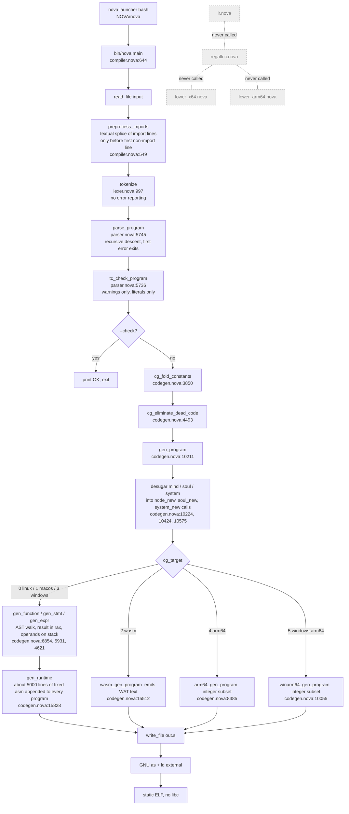

# nova_compiler — findings

Reviewer: `nova_compiler`. Scope: NOVA compiler, package manager, stdlib, tooling, storage, seed, build scripts.
All probes were run with the lead's `$S/NOVA/bin/nova` (built from HEAD `663bf0e`) on Linux x86-64; probe sources and outputs are in `$S/probes/nova_compiler/`.
Labels: CONFIRMED = read in code or reproduced by execution; LIKELY; SUSPECTED.

## Plain-language summary

Nova is a real, self-hosting compiler. About 32,000 lines of Nova read a source file, tokenize it, parse it into list-based syntax trees, and walk those trees once to print x86-64 assembly text, which GNU `as`/`ld` turn into a static Linux binary with no libc. The bootstrap works and reproduces itself byte-for-byte. That is a genuine achievement for a small team.

What it is not: it is not a typed language, and it does not have the layered back end its architecture document draws. There is no semantic analysis. Type annotations and generics are parsed and thrown away. Variables are function-scoped 64-bit words with no static type; an undefined variable compiles and reads garbage. The IR, register allocator and both "lowering" files are dead code — every program goes straight from syntax tree to stack-machine assembly. "Optimization" is constant folding, removal of unused pure `let`s, a few peepholes and tail-call-to-jump.

At runtime a value is either a 63-bit integer (stored as `2n+1`) or a raw pointer. Floats are raw IEEE bits that the compiler tracks by variable name within one function. Memory comes from a bump allocator that never frees. The whole runtime library is hand-written assembly held as string literals inside one 8,300-line function.

The project is mid-way through a change of integer representation (the "tagging rework"), and HEAD is visibly broken by it: `float_to_str` halves the integer part of every float, `exit(0)` exits with status 1 (so `nova --version` reports failure), enum variants with payloads crash, ten of twenty-seven builtins I sampled return wrong values (`sum([1,2,3,4])` is 12), the WAL test fails, and string `+` is wrong on WASM. The test runner only checks exit codes, so `test_float` passes while printing `pi = 1.140000`.

The MSC keywords (`mind`, `soul`, `system`, `~>`) are syntax sugar: the compiler rewrites them into ordinary calls to library functions such as `node_new` and `scheduler_register`. Nothing about them is special in the generated code.

Of six advertised targets, Linux x86-64 is the only one I could run end-to-end. WASM runs but miscompiles string concatenation. Windows and macOS x86-64 assemble but were not run. ARM64 and Windows-ARM64 are integer-only stubs.

## Compiler pipeline (actual)

Evidence: `NOVA/src/compiler/compiler.nova:609-642` (the whole `compile` function) and `:773-795` (`main`).

Notes for the diagram:
- IR / regalloc / lower_x64 are concatenated into the compiler (`NOVA/Makefile:10-18`) but no function in codegen.nova, parser.nova or compiler.nova calls any `ir_*`, `ra_*` or `lx_*` symbol (grep over the repo: only self-references). `lower_arm64.nova` is not even in the build; codegen says so itself (`NOVA/src/compiler/codegen.nova:7074-7077`). `NOVA/ARCHITECTURE.md:57-64, 259-298` draws these as live stages. CONFIRMED dead.
- Optimizations that really run: constant folding of literal arithmetic (`codegen.nova:4695-4758`, `3509`, `3850`); unused pure `let` removal and dead-branch removal (`:4493`); identity elimination for `-0 |0 ^0 <<0 >>0 /1` (`:4762-4780`); divide-by-power-of-two → shift (`:4782-4797`, which is wrong for negatives, see F-07); self tail call → `jmp` (`:6843`, verified with 5,000,000-deep recursion). `--no-opt` disables the first two (`:3851`, `:4494`).
- There is no semantic pass between parser and codegen other than `tc_check_program`.

## Findings table

| ID | Sev | Category | Title | file:line | Evidence | Impact | Recommended fix | Effort | Confidence |
|---|---|---|---|---|---|---|---|---|---|
| F-01 | Critical | Correctness | `float_to_str` halves the integer part of every float | NOVA/src/compiler/codegen.nova:20448-20453 | Raw `cvttsd2si` result is passed to `_nova_int_to_str`, which now untags (`sar 1`). `tests/test_float.nova` prints `pi = 1.140000`, `10.0 = 5.000000`; probe `float_to_str(123456789.125)` → `61728394.125000`. | Every printed float is wrong. Any downstream "measurement" printed through this is wrong. | Tag before the call (`lea rdi,[rdi+rdi+1]`), add output-comparing test. | S | CONFIRMED |
| F-02 | Critical | Test integrity | Test runner passes on exit code only | NOVA/tests/run_tests.sh:361-366 | `test_float` is reported PASS while printing wrong numbers (F-01). No expected-output comparison. | The 157-pass figure overstates correctness; regressions in printed values are invisible. | Golden-output files per test; fail on diff. | M | CONFIRMED |
| F-03 | Critical | Correctness | Built-in map has 16 fixed slots and never grows; 17th key hangs forever | NOVA/src/compiler/codegen.nova:19865 (capacity), 19905-19955 (`_nova_map_set`, no resize, unbounded probe loop) | Probe: 16 inserts OK; 17 inserts → killed by timeout. 100 and 20,000 inserts hang. | Any program (or `nova pkg` with >16 deps) using `map_new` beyond 16 keys freezes with no message. | Add load-factor resize; bound the probe loop. | M | CONFIRMED |
| F-04 | High | Correctness | `exit(n)` exits with status `2n+1`; `exit(0)` reports failure | NOVA/src/compiler/codegen.nova:16696-16717 (no untag of rdi) | `exit(0)` program → rc 1; `exit(1)` → rc 3. `bin/nova --version` → rc 1; `bin/nova --check ok.nova` → rc 1; compile errors → rc 3. Contradicts the comment at compiler.nova:650-652 ("need … exit 0"). | Install scripts, Homebrew test, CI and any shell `&&` chain see success as failure. | `sar rdi,1` (or `sar edi,1`) at `_nova_exit` entry on all targets. | S | CONFIRMED |
| F-05 | High | Language safety | No semantic analysis: undefined variables compile and read stack garbage | NOVA/src/compiler/codegen.nova:4684-4686; `local_offset` 688-706 | Unknown identifier falls through to `local_offset`, which appends a new slot after the frame size was computed. Probe `println(int_to_str(nosuchvar + 1))` → prints `2099233`, rc 0. | Typos become silent wrong answers or stack corruption. | Resolve names in a pass before codegen; hard error. | M | CONFIRMED |
| F-06 | High | Language safety | `let x` inside a function silently writes the global `x`; no block scope | NOVA/src/compiler/codegen.nova:885-890 | `collect_locals` skips names that are globals. Probe: global `x = 1`; `fn f(){ let x = 2 }`; after `f()`, global prints 2. Inner `let y = 6` in an `if` overwrites the outer `y`; loop-body `let t` is visible after the loop. | In a 190k-line code base built by textual concatenation of files, any local that shares a name with any global in any imported file corrupts it. | Proper scopes; at minimum warn on local/global name clash. | M | CONFIRMED |
| F-07 | High | Miscompile | `a / 2` (literal power of two) rounds toward −∞, `a / two` truncates | NOVA/src/compiler/codegen.nova:4782-4797 | Probe: `a=-7`: `a / 2` → `-4`; `a / two` → `-3`; `-7 / 2` (folded) → `-3`. | Same expression gives different answers depending on whether the divisor is a literal. | Add bias before `sar` or drop the peephole. | S | CONFIRMED |
| F-08 | High | Regression | Enum variants with payloads segfault at HEAD | probes `en3.nova`, `en4.nova`; lead's log `test_sum_types (exit code: 139)` | `enum Shape { Circle(int) … }` + `match` → SIGSEGV even when exhaustive. README lists this as a headline feature (README.md:252). Root cause not isolated. | Sum types, `Result`, `?` propagation unusable. | Bisect against tagging-rework commits. | M | CONFIRMED (symptom); cause SUSPECTED tagging rework |
| F-09 | High | Memory safety | Index assignment and several string builtins have no bounds checks | NOVA/src/compiler/codegen.nova:6396-6410 (`l[i]=v`), 17051-17055 (`list_set`), 16931-16944 (`char_at`), 16947-16980 (`substr`), 16885-16887 (string index) | Probe: 3-element list, `l[4..7] = …` succeeds silently; `l[100000000]=1` → SIGSEGV; `char_at("abc",100)` returns a byte from elsewhere; `substr(s,1,1000)` copies past the end. List *reads* are checked. | Heap corruption and out-of-bounds reads from ordinary code. | Mirror the read-side check on writes; clamp in substr/char_at. | S | CONFIRMED |
| F-10 | High | Type confusion | Values carry no type; wrong-kind operands crash or do pointer arithmetic | NOVA/src/compiler/codegen.nova:15922-15931 (`_nova_add`), 16655-16680 (`_nova_len`) | `"a" + 5` → pointer+10, prints part of an unrelated runtime string (`e error: null pointer access`) and continues with rc 0. `println(5)`, `len(5)`, `push(0,1)`, `m["a"]` on a map, a float passed through a function parameter → SIGSEGV. A string beginning with eight 0xFF bytes is treated as a list (`len` → 1818845556) because lists are recognised by a `-1` first word (`:16665`). | No error messages for the most common beginner mistakes; data-dependent misbehaviour. | Header word on every heap object or wider tags; runtime type errors. | L | CONFIRMED |
| F-11 | High | Type system | Annotations and generics are parsed and discarded | NOVA/src/compiler/parser.nova:4827-4836 (design note), 4957-4979 (`tc_literal_type`), 5736-5743 | `let x: int = "s"`: no diagnostic. `let y: bogus_type_name = 5`: none. `fn r() -> int { return "notint" }`: none. Literal argument mismatch prints `warning:` and compiles. `id<int>(5)` parses as chained comparison and returns 1/0. README says so honestly ("All annotations erased at codegen", README.md:252). | "Typed" source gives no guarantees; generic call syntax silently miscompiles. | Either implement checking or state "dynamically typed" in the top-line description; reject `f<T>(…)`. | L | CONFIRMED |
| F-12 | High | Architecture / docs | IR, register allocator and both lowering passes are dead code | NOVA/src/compiler/ir.nova, regalloc.nova, lower_x64.nova, lower_arm64.nova; NOVA/Makefile:10-18; codegen.nova:7074-7077 | No caller of `ir_init`, `ra_allocate`, `lx_lower_function`, `la_lower_function` outside their own files. 2,139 lines. ARCHITECTURE.md:57-64 shows them as pipeline stages. | Maintenance cost; documentation describes a compiler that does not exist. | Delete or wire in; correct ARCHITECTURE.md. | S | CONFIRMED |
| F-13 | High | Portability claims | ARM64 and Windows-ARM64 are stubs; WASM miscompiles string `+` | NOVA/src/compiler/codegen.nova:7083-7088 (declared subset), 7929 ("unsupported arm64 expression tag" → emits `mov x0,#0`), 9376 | ARM64 hello with a list/map/`int_to_str`: assembles with clang but leaves `int_to_str`, `map_new`, `map_get`, `map_set` undefined and replaces a list literal with 0. WASM under Node WASI: `"hello " + int_to_str(55) + " " + …` prints `" 4"`; `a + "world"` prints an empty line; `concat()` works; maps are undefined functions in the WAT. | "6 targets" is really 1 working, 1 partial-and-wrong, 2 unverified, 2 stubs. Unsupported constructs are silently replaced by 0 instead of failing. | Fail compilation on unsupported nodes; fix WASM `+`; describe targets honestly. | M | CONFIRMED |
| F-14 | High | Security | No sandbox of any kind; language exposes raw machine access | NOVA/src/compiler/codegen.nova:6676-6684 (inline `asm` copied verbatim), 2036-2367 (builtins: `system_exec`, `exec_program`, `fork_process`, sockets, `ffi_open/sym/call*`, `store64/load64/store8/memcpy_raw`, `unlink`, `write_file`), 24077-24084 (`system_exec` → libc `system`) | Probe `asm { "mov rax, 85" }` runs. | Fine for a systems language; unacceptable if Nova is ever used to run untrusted or machine-generated code (e.g. self-modifying "AGI" loops). | Document; add a `--safe` mode that rejects asm/FFI/raw memory/exec. | M | CONFIRMED |
| F-15 | Medium | Diagnostics | Lexer reports nothing; parser stops at first error | NOVA/src/compiler/lexer.nova:985-986 (unknown char skipped), 246-300 (no overflow check); parser.nova:76-102 | `let s = "unterminated` compiles and the program prints nothing. `5 $ 3` → `$` dropped. `99999999999999999999999` → `200376420520689663`. `12abc` accepted. Parser errors have a line number, but the context line prints the rest of the file up to 80 bytes and the caret is misplaced. | Typos become silent behaviour changes. | Error on unknown byte, unterminated string, literal overflow; fix `par_get_source_line`. | S | CONFIRMED |
| F-16 | Medium | Correctness | Integer literals are limited to ±2^61; larger ones wrap silently | NOVA/src/compiler/codegen.nova:4624-4627 | The compiler computes `(n<<1)|1` in its own 63-bit integers. `2305843009213693952` (2^61) prints `-2305843009213693952`; `4611686018427387903` prints `-1`; `0x7FFFFFFFFFFFFFFF` prints `-1`. Runtime integers are 63-bit and wrap silently (`2**62` → 0). | 64-bit constants (hashes, masks, CRC polynomials above 2^61, nanosecond times) cannot be written. | Emit literals from decimal text, not via arithmetic; error on out-of-range. | S | CONFIRMED |
| F-17 | Medium | Correctness | Function calls are not arity-checked; duplicate functions surface as assembler errors | probes `p17`, `q12`, `nm1`, `nm2` | `two(1)` → `70363225852469`; extra args ignored; two `fn dup` → `as: symbol 'dup' is already defined`; `fn rax()` compiles and segfaults (`call rax`); a user `fn _nova_add` collides with the runtime. | Errors appear at the wrong layer or not at all. | Arity check in the registry sweep; mangle user symbols. | S | CONFIRMED |
| F-18 | Medium | Robustness | Deep recursion and deep nesting crash with bare SIGSEGV | probes `p05`, `q15`, `deep.nova` | 10M-deep non-tail recursion → rc 139, no message. Compiler itself segfaults on 10,000 nested parentheses (5,000 is fine). | No stack-overflow diagnostics for programs or the compiler. | Guard page handler or depth counter. | M | CONFIRMED |
| F-19 | Medium | Performance | Symbol lookup is linear; compile time is quadratic in globals | NOVA/src/compiler/codegen.nova:666-675 (`is_global`), 590-602 (`add_string`), 93-95 (`_cg_ht_hash` = `len(name) % 8`) | 1 MB file with 45,000 globals: 24.8 s to compile. The "hash table" hashes by string length into 8 buckets. | Matters for the 190k-line consumer that is compiled as one concatenated unit. | Real string hash; grow buckets. | S | CONFIRMED |
| F-20 | Medium | Memory | Bump allocator never frees | NOVA/src/compiler/codegen.nova:16346-16420 | `brk`/`mmap` in 1 MiB steps; no free, GC or arena reset label exists in the runtime. `s = s + "x"` in a loop allocates a new string each time. | Long-running processes (servers, "always-on" agents) grow without bound. | Arena scopes or a real allocator. | L | CONFIRMED |
| F-21 | Medium | Regression | `src/storage/wal.nova` test fails at HEAD and is skipped by the runner | NOVA/tests/run_tests.sh:23; probe `walt.nova` | Built per the recipe in the test header: prints `open writer`, `FAIL`, `seq 0 assigned`, rc 3. File on disk has 3 well-formed 23-byte records. Cause LIKELY the `store64`/`load64` tagged-zero special case (commit b7892d8). | Storage layer's only test is red and nobody sees it. | Un-skip (it only needs /tmp); fix load64/store64 contract. | S | CONFIRMED (failure); cause LIKELY |
| F-22 | Medium | Correctness | WAL keeps appending after a torn record, making later records unreachable | NOVA/src/storage/wal.nova (`wal_open`, `wal_read_next`, `wal_recover_next_seq`) | `wal_open` opens with `O_APPEND` and never truncates a torn tail; the reader stops at the first bad record. Records appended after a crash-torn tail are never replayed unless the caller remembers to call `wal_truncate_to`. Also: short writes not retried; every `wal_read_next` allocates 20 bytes that are never freed. | Silent data loss after one crash. | Truncate to last valid offset inside `wal_open`. | S | LIKELY (by reading; not reproduced) |
| F-23 | Medium | Regression | `src/stdlib/float.nova` helpers return 0 at HEAD | probe `sf.nova` | `f_clamp(5.0,0.0,3.0)`, `f_lerp(0.0,10.0,0.5)`, `f_distance(0,0,3,4)` all print `0.000000`; `f_to_int(f_distance(…))` → 0. Floats lose their "float" marking when passed through untyped parameters (`is_float_expr`, codegen.nova:2947-2990 is purely syntactic), so helper bodies run integer code on IEEE bits. | Float math through any user function is unreliable. | Needs a real float representation (boxed or NaN-boxed). | L | CONFIRMED (symptom); cause LIKELY |
| F-24 | Medium | Build | Bootstrap seed is a 5½-month-old compiler snapshot with the old buggy classifier | NOVA/boot/nova_boot.s:2 (`.file 1 "/tmp/nova_combined.nova"`), NOVA/Makefile:23-34 | Compiler output, not hand-written (has `.loc` lines, compiler naming). Last changed 2026-05-31 (e4289df); 75 compiler commits since; defines 304 of today's 479 compiler functions; still contains 13 copies of `cmp rdi, 0x100000`. Makefile documents that stage 1 can crash under ASLR and ships `setarch -R` wrappers. | Build from clean checkout depends on heap address luck; any new syntax used in the compiler source must stay compilable by the May compiler. | Re-seed from current stage 2 after fixing F-01/F-04; drop the setarch wrappers. | S | CONFIRMED |
| F-25 | Medium | Correctness | `sort()` on strings does not sort lexicographically; runtime bounds-error message prints index/2 | probes `sr.nova`, `p10`, `r08`; codegen.nova:16912-16918 | `sort(["pear","apple","fig"])` → unchanged order. `l[3]` out of bounds prints `index out of bounds: 1`; `l[5]` prints `2` (raw index passed to tag-expecting print). | Wrong results; misleading diagnostics. | Compare with `_nova_strcmp` for pointers; tag before print. | S | CONFIRMED |
| F-26 | Medium | MSC | Flow-operator runtime compares tagged lengths against raw 0 | NOVA/src/compiler/codegen.nova:23427-23436 | `_nova_flow_fwd` does `call _nova_len; cmp rax, 0` (tagged zero is 1) and passes raw `0` as an index. Lead's log: `test_flow_ops` fails. | `~>` family is broken at HEAD. | Update to tagged constants. | S | LIKELY |
| F-27 | Low | Packaging | Installed compiler cannot find its standard library | NOVA/Makefile (install target installs only bin/nova, man page, docs); compiler.nova:379-495 | `import "std/x"` searches `nova_packages/`, `--nova-root`, then `src/runtime` etc. relative to the current directory. No packaging script ships `src/runtime`. | A .deb/.pkg/.msi install can compile only import-free programs. | Install the library under `share/nova` and default `--nova-root` to it. | S | LIKELY |
| F-28 | Low | Hygiene | Three different version numbers; orphan and stale build files | NOVA/VERSION (0.1.0); NOVA/src/version.nova:7 (0.2.0, unreferenced); NOVA/nova `version` branch (0.9.0); NOVA/build_compiler.sh:7-12 (5 of 9 sources) | — | Confusion about what is shipped. | Single source of truth; delete orphans. | S | CONFIRMED |
| F-29 | Low | Hidden dependency | GPU path is a Rust/wgpu sidecar | NOVA/scripts/wgpu_dispatch/src/main.rs:1-23; Cargo.toml | Nova writes a WGSL text file and a config; a Rust binary does the GPU work. The compiler's dependency table also knows std packages named `llm`, `python`, `blas`, `embed`, `cognitive_llm`, `gpu` (compiler.nova:159-173; pkg.nova:29-97) — those files are in another reviewer's scope but their existence is relevant to the "no LLM / no BLAS" claim. | "No external dependencies" holds for the compiler core, not for the ecosystem. | State it plainly. | S | CONFIRMED (sidecar); package contents not reviewed here |
| F-30 | Low | Hygiene | Launcher hides assembler errors and leaks compiler output | NOVA/nova (`run` branch: `as … 2>/dev/null`, `grep -v "^===" \|\| true`) | `nova run` prints `Compiled: … -> /tmp/…/out.s` into the program's stdout; on a compile error the user sees the parser message, then a silent `as` failure. Every emitted `.s` lacks a trailing newline (assembler warning on every build). | Noise; breaks scripts that parse program output. | Send compiler chatter to stderr; add final newline. | S | CONFIRMED |
| F-31 | Low | Naming | Tooling names overstate function | NOVA/src/tooling/time_machine.nova:119-145; profiler.nova:34-38, 204-216 | "Time-travel debugger … replay" copies stored snapshot lists and overwrites fields. "Profiler" counts manually-incremented ticks. "Flamegraph" is `name total` lines. | Reader expects more than is there. | Rename or document. | S | CONFIRMED |
| F-32 | Critical | Regression | Many runtime builtins return wrong values at HEAD (tag/untag mismatches) | NOVA/src/compiler/codegen.nova:15828-24119 (`gen_runtime`; individual helpers not all located) | One-line probes `b_*.nova`, `sl3.nova`: `sum([1,2,3,4])` → 12; `product([1,2,3,4])` → 472; `len(list_slice([1,2,3,4],1,3))` → 1; `len(filter(l, x>2))` → 4; `reduce(l,0,add)` → SIGSEGV; `pad_left("7",3,"0")` → `0000007`; `len(unique([1,1,2]))` → 0; `hex(255)` → `0x1ff`; `any([0,0,1], x==1)` → 0; `str_count("banana","a")` → 1. Correct in the same run: abs, min, max, range, index_of, reverse, split, str_find, contains, pop, min_list, max_list, str_to_int, str_upper, keys, to_str, str_replace. 10 of 27 sampled builtins are wrong. | Any library code using these gets silently wrong numbers. `src/stdlib/list.nova` wraps `sum`, `filter`, `list_slice`, `reduce`, so it inherits the faults. | Table-driven test of every builtin with golden outputs; audit each helper for tagged-in/tagged-out. | M | CONFIRMED |

## Answers to the lead's questions

### 1. Pipeline
See the diagram. `codegen.nova` emits assembly straight from the AST as a stack machine: each expression leaves its result in `rax`, binary operators push one side (`codegen.nova:4803-4818`), locals live at `[rbp - 8k]`, the first six arguments go in SysV registers and are spilled on entry. `+`, `*`, `==`, `!=` call runtime helpers that dispatch on the tag bit at run time (`:4819-4864`); `-`, `/`, `%`, comparisons and bit operations are inline. IR/regalloc/lower_x64 are dead (F-12).

### 2. Type system
None enforced. No ownership model exists in the compiler (no borrow/move/lifetime code; grep finds none). Generics are skipped by `par_skip_type` and erased. The only static checks are: undeclared *callee* is a hard error (`codegen.nova:5064-5078`, message `ERROR: undeclared callee: name`, no line number); literal-argument type mismatches and non-exhaustive enum matches are warnings. A "type error" at run time is a segfault or a silent wrong value (F-10).

### 3. Value representation and memory
- Integers: `2n+1`, 63-bit signed, silent wraparound; literals limited to 62 bits (F-16). Booleans are tagged 0/1; `None` is tagged 0.
- Pointers: raw, bit 0 clear. Classifier is now `test rdi, 1` (`codegen.nova:15842-15848`); the older address-range classifier is left as unreachable code beneath it, and the comment block above it (`:15831-15835`) still describes the old scheme. `PTR_THRESHOLD` (`:8`) is unused. The `cmp rdi, 0x100000` heuristic survives only in the seed (F-24). Large-literal probes (0x100000+1, 16777217*3, 2^40*1024, 0x100000², 2^34+5) are all correct at HEAD.
- Some pointers from `alloc()` travel as *tagged* integers, so many builtins start with "untag if bit 0 set" prologues (e.g. `:16656-16663`, `:16931-16940`). The code base calls this "two-tier tag polymorphism". It is the source of most HEAD regressions.
- Strings: NUL-terminated byte arrays; `len` is O(n) and counts bytes. `len("مرحبا")` = 10, `len("a😀b")` = 6; `substr(s,0,1)` yields half a code point. UTF-8 passes through intact for print, concat and equality. No Unicode awareness.
- Lists: header `[-1, len, cap, data*]`; maps `[-2, count, 16, slots*]` with fixed capacity (F-03).
- Floats: raw IEEE-754 double bits in the same 64-bit slot, indistinguishable from ints/pointers at run time; float code is selected at compile time by variable name within one function (`:2947-2990`). `0.1+0.2 != 0.3` and `NaN != NaN` behave per IEEE. Printing is broken (F-01); `1.0/0.0` prints nothing useful.
- Allocator: bump, never frees (F-20). Division by zero is caught with a message and rc 1. List reads are bounds-checked; writes are not (F-09).

### 4. Targets

| Target | Flag | Verdict | Evidence |
|---|---|---|---|
| Linux x86-64 | default | **Working, with the bugs above** | Self-hosts; all probes ran here. |
| WASM/WASI | `--target=wasm` | **Partial — runs, miscompiles** | WAT validated and run under Node WASI via `wabt`: fib, lists, big-int multiply correct; string `+` wrong; maps missing (F-13). ~4,300 lines of dedicated codegen. |
| Windows x86-64 | `--target=windows` | **Partial — unverified** | Assembles with `clang --target=x86_64-w64-mingw32`; imports 40 Win32 APIs; 50 `cg_target == 3` branches inside the shared runtime. No mingw linker or wine here, not run. |
| macOS x86-64 | `--target=macos` | **Partial — unverified** | Assembles with `clang --target=x86_64-apple-darwin`; 9 target branches (section names, syscall numbers, mmap heap). Intel only; no Apple Silicon. Not run. |
| ARM64 Linux | `--target=arm64` | **Stub** | Integers, if/while, calls, `println(string)`; list/len/push/file builtins exit(1); everything else undefined or replaced by 0 (F-13). |
| Windows ARM64 | `--target=windows-arm64` | **Stub** | Same subset as ARM64 with PE directives; same undefined symbols. |

### 5. Diagnostics and grammar
Lexer: none. Parser: first error only, `error[line N]: expected X but got Y`, exit status 3. No recovery. No formal grammar (no EBNF/BNF file in the repo; the nearest thing is the tree-sitter grammar under `tools/`, outside my scope, and the README feature list). Precedence observations: `-2 ** 2` = 4 (unary binds tighter than power); `1 < 2 < 3` chains Python-style; `1 << 2 + 1` = 8.

### 6. MSC constructs
`mind`, `soul`, `system` are keywords (`lexer.nova:661-663`) with dedicated parsers (`parser.nova:3968`, `4197`) and AST tags, but `gen_program` rewrites each declaration into ordinary statements before code generation:
- `mind M { nodes… }` → `scheduler_ensure_init()`, `let M_x = node_new("x", type)`, `scheduler_register(M_x)`, plus lists of names (`codegen.nova:10224-10300`).
- `soul S {…}` → `soul_new("S")`, `soul_set_identity(…)` and similar setters (`:10424-10450`).
- `system Y {…}` → `system_new("Y")`, `system_add_mind(…)` (`:10575-10600`).
- `a ~> b` and the six sibling operators → `call _nova_flow_fwd` etc., small runtime stubs that call the library functions `node_receive`, `node_process`, `node_drain_outbox` (`:5501-5517`, `:23410-23440`).
All of those callee names are plain Nova functions in `src/core` / `src/runtime` that the program must import. The compiler contributes naming conventions and nothing else. So: first-class *syntax*, zero special *semantics*.

### 7. Capabilities
See F-14. A Nova program can run arbitrary assembly, call any libc/dlopen symbol (with `--link-libc`), fork/exec, open sockets, read/write/delete files, and peek/poke arbitrary addresses. There is no capability model, no sandbox flag, no restricted mode.

### 9. pkg / tooling / storage / stdlib
- `src/pkg`: Partial. Local manifest editing works (`init`, `add`, `list`, `remove` exercised). `install` only copies bundled std files and, via the launcher, looks in `./src/runtime` so it fails outside the repo root. No remote packages. Accepts `../../evil` as a package name (stored as "local", not acted on).
- `src/tooling`: small real data-recording libraries; names overstate (F-31). Not compiler tooling.
- `src/storage/wal.nova`: real and reasonably designed, currently red (F-21, F-22).
- `src/stdlib`: two files, not on the import path (the compiler resolves `std/float` to `src/runtime/float.nova`, a different file). Both are thin wrappers and both give wrong results at HEAD because the builtins beneath them do (F-23, F-32).

### 10. Twenty riskiest functions

| # | Function | file:line | LOC | Why |
|---|---|---|---|---|
| 1 | `gen_runtime` | codegen.nova:15828 | 8292 | Entire runtime as string-literal assembly for 3 OS targets in one function; every tagging bug lives here; no unit tests per helper. |
| 2 | `gen_expr` | codegen.nova:4621 | 1310 | One if-chain over ~60 node tags; hand-managed stack pushes/pops; silent fallthrough for unknown identifiers. |
| 3 | `wasm_gen_rt_extra` | codegen.nova:12902 | 1705 | Second copy of the runtime in WAT; diverges from x86 semantics (string `+`). |
| 4 | `gen_program` | codegen.nova:10211 | 963 | MSC desugaring, registry sweeps, globals, entry point all inline; order-dependent. |
| 5 | `gen_stmt` | codegen.nova:5931 | 863 | Unchecked index/field stores; loop/defer/try label state in globals. |
| 6 | `wasm_gen_rt_simd` | codegen.nova:14607 | 905 | Hand-written SIMD in WAT text. |
| 7 | `wasm_gen_expr` | codegen.nova:11398 | 659 | Parallel reimplementation of `gen_expr`; must be kept in sync by hand. |
| 8 | `arm_gen_call` | codegen.nova:7276 | 529 | Builtin dispatch for a target with almost no runtime; silently emits calls to undefined symbols. |
| 9 | `warm_emit_runtime` | codegen.nova:9541 | 514 | Third runtime copy (Windows ARM64). |
| 10 | `parse_primary` | parser.nova:496 | 381 | Generic-vs-comparison and struct-init-vs-block disambiguation by lookahead. |
| 11 | `emit_inline_simd` | codegen.nova:2415 | 366 | Raw AVX/SSE sequences emitted inline, untagged/tagged mixing. |
| 12 | `is_builtin_fn` | codegen.nova:2036 | 332 | 230-way string compare; must match three other tables (dispatch, WASM, ARM) by hand. |
| 13 | `parse_match` | parser.nova:2633 | 322 | Rewrites patterns into guarded wildcards with synthetic temporaries. |
| 14 | `warm_gen_call` | codegen.nova:8773 | 322 | As #8 for Windows ARM64. |
| 15 | `arm_emit_runtime` | codegen.nova:8090 | 295 | Stub runtime that exits(1) for most builtins. |
| 16 | `lex_all` | lexer.nova:741 | 256 | 25-deep nested else chain; unknown bytes dropped. |
| 17 | `gen_function` | codegen.nova:6854 | 249 | Frame size fixed before body is generated, yet `local_offset` can add slots later (F-05). |
| 18 | `collect_idents_in` / `cg_collect_inner_lambdas` | codegen.nova:1441 / 1781 | 247 / 183 | Closure capture analysis; captures are by reference via boxes (loop closures all see the final value). |
| 19 | `parse_soul` | parser.nova:4197 | 243 | Large bespoke sub-grammar for one declaration form. |
| 20 | `cg_fold_expr` + `_cg_dce_*` | codegen.nova:3509, 3952, 4110 | 215 + 277 | Optimizer mutates AST in place; purity analysis decides what code is deleted. |

### 11. Code quality of codegen.nova
- 24,119 lines, 171 functions, one file. 8,549 lines (35%) are `out("…")`-style calls emitting literal assembly; the runtime exists three and a half times (x86 for Linux/macOS/Windows interleaved, WAT, ARM64 stub, Windows-ARM64 stub).
- Per-target branching is by integer comparison `cg_target == 3` etc. (91 occurrences) scattered through the runtime, not by table or interface. Targets 0/1/3 share one function body; 2/4/5 are complete parallel reimplementations of `gen_expr`/`gen_stmt`.
- Magic numbers everywhere: AST tags by position (`nd[3]`, `nd[ndlen-1]` is the line), syscall numbers, struct offsets `+8/+16/+24`, type sentinels `-1`/`-2`, tag constants `1`/`3`, heap chunk `1048576`. 99 hand-placed `sar reg, 1` untags and 52 `lea rax,[rax+rax+1]` retags; each missing or extra one is a bug of the F-01/F-04 kind.
- Symbol tables are parallel global lists with linear search (F-19). State is in ~70 mutable globals (`cg_*`), reset by hand per function.
- Comments are plentiful and candid — many record the bug that motivated the line — but some are now wrong (e.g. `:15831-15835`, `tests/test_float.nova:1-2` says "fixed-point, scale factor 1000").
- Positive: label generation, string pooling, DWARF line info and the Win64 alignment notes show care; the constant folder and DCE are conservative; self-host fixed point is a strong regression guard for the subset of the language the compiler itself uses. That subset excludes floats, maps beyond a hand-rolled bucket list, enums with payloads and flow operators, which is exactly where HEAD is broken.

## Probe results

Linux x86-64 unless noted. "rc" is the process exit status of the compiled program (or of the compiler for compile-time probes). Files are in `$S/probes/nova_compiler/`.

| # | Probe (file) | Program essence | Expected | Actual | Verdict |
|---|---|---|---|---|---|
| 1 | q01_intrange | print literals 2^60, 2^61−1, 2^61, 2^62−1 | same numbers | `1152921504606846976`, `2305843009213693951`, `-2305843009213693952`, `-1` | **BUG** literals ≥2^61 wrap (F-16) |
| 2 | q01_intrange | `(2^62−1)+1` at run time | error or wrap | `-4611686018427387904` silently | By design: 63-bit silent wrap |
| 3 | p01/p22 | `2147483648*2147483648`, `1<<62`, `2**62` | 2^62 or error | `0` | Silent overflow (63-bit) |
| 4 | p02_biglit | `0x100000+1`, `16777217*3`, `2^40*1024`, `0x100000*0x100000`, `2^34+5`, `0xFFFFFFFFFFFF` | exact | all exact | PASS — old pointer-threshold bug is fixed in HEAD |
| 5 | p03_neg | `-7/2`, `-7%3`, `7%-3`, `-8>>1`, `-1&255`, `(-5)*(-5)` | −3, −1, 1, −4, 255, 25 | same | PASS (C-style truncation) |
| 6 | sr | `a=-7; a/2` vs `a/two` | equal | `-4` vs `-3` | **BUG** (F-07) |
| 7 | p04_divzero | `10 / z`, z=0 | runtime error | `Runtime error: division by zero`, rc 1 | PASS |
| 8 | p05_recurse | non-tail recursion depth 10,000 then 10,000,000 | result, then clean error | `10000`, then SIGSEGV rc 139, no message | Weak (F-18) |
| 9 | tco | self tail call depth 5,000,000 | 5000000 | `5000000` | PASS (TCO real) |
| 10 | p06_closure | 3 closures capturing loop var `i` | 0,1,2 (by value) or 3,3,3 (by ref) | `3,3,3`; `mk(5)(10)`=15; counter=2 | By-reference capture; works as designed |
| 11 | q02_shadow | `let x` in fn with global `x`; inner-block `let` | global unchanged; block-scoped | global becomes 2; inner `let` overwrites outer; loop-body var visible after loop | **BUG** (F-06) |
| 12 | p08/q04 utf8 | `len("مرحبا")`, `len("a😀b")`, `substr(s,0,1)`, concat, `==` | 5 / 3 chars, or documented bytes | 10, 6; substr gives half a code point; print/concat/eq fine | Bytes only; no Unicode |
| 13 | q03_float | `float_to_str` of 3.0, 300.0, 123456789.125, −1.5 | as written | `1.000000`, `150.000000`, `61728394.125000`, `-0.500000` | **BUG** (F-01) |
| 14 | q03_float | `0.1+0.2==0.3`; `NaN==NaN` | false; false | false; false | PASS (IEEE) |
| 15 | q03/p09 | `float_to_str(1.0/0.0)`; `println(float)` | `inf`; number | garbage / empty; SIGSEGV | **BUG** |
| 16 | r03_floatfn | `fn mul(a,b){return a*b}; mul(1.5,2.0)` | 3.0 | SIGSEGV | **BUG** (F-10/F-23) |
| 17 | p10/q08 | list read `l[3]` of 3; `l[-1]` | bounds error; last element | `Runtime error: index out of bounds: 1` rc 1; `3` | Check works; message prints index/2 (F-25) |
| 18 | q09/r04 | `l[10]=5` on 3-element list; `l[100000000]=1`; `char_at("abc",100)`; `substr(s,1,1000)` | bounds errors | silent success; SIGSEGV; `105`; `bc` + over-read | **BUG** (F-09) |
| 19 | p11/q07 | map with `"1"` and `1` keys; missing key | distinct; 0 | distinct; `0` | PASS |
| 20 | mg (16/17/100/20000 keys) | insert N keys into `map_new()` | works | 16 OK; 17+ hang until killed | **BUG** (F-03) |
| 21 | m2 | `{"a":1}` then `m["a"]` | 1 | `map_get` → 1; `m["a"]` → SIGSEGV | **BUG** (F-10) |
| 22 | p12/q11 | `let x: int = "s"`; `let y: bogus = 5`; `fn r() -> int {return "s"}`; `add("foo","bar")` with `a: int` | compile errors | no diagnostic ×3; warning only for the call, prints `foobar` | Types not enforced (F-11) |
| 23 | q10_generic | `id<int>(5)` | 5 or syntax error | `1` | **BUG** silent misparse (F-11) |
| 24 | p13_undef | call undefined function | compile error with line | `ERROR: undeclared callee: undefined_function`, rc 3, no line | PASS (no location) |
| 25 | p14_undefvar | use undefined variable | compile error | compiles; prints `2099233` | **BUG** (F-05) |
| 26 | p17_argc | `two(1)`, `two(1,2,3)` | errors | `70363225852469`; `3` | **BUG** (F-17) |
| 27 | p15/p16/l4/l5 | missing `)`, `fn f( {`, EOF in call, missing `}` | located errors | `error[line N]: expected ) but got }` etc.; context line garbled; one error then exit | Adequate message, poor context, no recovery (F-15) |
| 28 | l1/l2/l3 | unterminated string; stray `$` and backtick; 23-digit literal; `12abc` | lexical errors | all compile silently; literal → `200376420520689663` | **BUG** (F-15) |
| 29 | q15/deep | N nested parentheses | parse | OK to 5,000; compiler SIGSEGV at 10,000 | Weak (F-18) |
| 30 | q16_big | 1 MB source, 45,000 globals | compiles | compiles in 24.8 s | Slow, quadratic (F-19) |
| 31 | q17_longexpr | `1 + 1 + …` ×30,000 | compiles | 0.04 s | PASS |
| 32 | q06/p02 | `"a" + 5` | error or "a5" | prints `e error: null pointer access` (bytes of another string), continues rc 0 | **BUG** (F-10) |
| 33 | q05/p18/q14 | `println(5)`; `len(5)`; `push(0,1)` | error or value | SIGSEGV each | **BUG** (F-10) |
| 34 | r06_listmark | `len` of string starting with 8×0xFF | 12 | `1818845556` | **BUG** type confusion (F-10) |
| 35 | ex/ex0 | `exit(0)`, `exit(1)` | rc 0, 1 | rc 1, 3 | **BUG** (F-04) |
| 36 | en2/en3/en4 | enum with payload + match | 12, 0 | SIGSEGV | **BUG** (F-08) |
| 37 | r08_trycatch | `throw "boom"` in try; OOB read in try | both caught | first caught; OOB aborts the process | Runtime errors not catchable |
| 38 | r10_asm | `asm { "mov rax, 85" }` | executes | returns 42 (raw 85 seen as tagged) | Works; no sandbox (F-14) |
| 39 | r12 | `3 < "3"`; `if ""`; `!5` | error; falsy; 0 | true; truthy; 0 | Untyped comparisons; empty string truthy |
| 40 | sr | `sort(["pear","apple","fig"])` | apple,fig,pear | pear,apple,fig | **BUG** (F-25) |
| 41 | nm1/nm2/q12 | `fn rax()`; `fn _nova_add`; duplicate fn | diagnostics | SIGSEGV at run; assembler errors | **BUG** (F-17) |
| 42 | nm3 | escapes `\" \\ \t`, `${name}` interpolation | correct | correct | PASS |
| 43 | nm4 | 8-arg call, `for x in list`, `0..5`, precedence | correct | correct (`-2**2` = 4) | PASS |
| 44 | r05/p23 | 20,000 string appends; 3M small allocs; 50M pushes | works | works | PASS (never frees) |
| 45 | fv | float-named var in one fn, int same name in another | 7 | 7 | PASS |
| 46 | t_hello ×6 targets | fib + list + map + int_to_str | assemble/run | see target table | F-13 |
| 47 | wasm t_hello2 / wc | string `+` under Node WASI | `hello 55 4`, `hello world`, `x55y` | ` 4`, empty line, `y` | **BUG** (F-13) |
| 48 | sf (stdlib/float) | `f_clamp`, `f_lerp`, `f_distance` | 3.0, 5.0, 5.0 | `0.000000` ×3 | **BUG** (F-23) |
| 49 | sl / sl3 (stdlib/list + builtins it wraps) | `sum`, `list_slice`, `filter`, `reduce`, `map_list` | 10, 2, 2, 10, doubled list | `sum`→12; slice len 3 and 1; filter keeps all 4; `reduce` SIGSEGV; `map_list` correct | **BUG** (F-32) |
| 49b | b_1 … b_22 | 22 one-line builtin checks | correct values | 8 wrong: product 472, pad_left `0000007`, unique 0, hex `0x1ff`, any 0, str_count 1, list_slice 1 (plus sum above) | **BUG** (F-32) |
| 50 | walt (test_wal) | WAL test per its own recipe | all checks pass | `FAIL seq 0 assigned`, rc 3 | **BUG** (F-21) |
| 51 | pkgt2 | `nova pkg init/add/list/install/remove` | manifest edits | works; `install` finds nothing outside repo root | Partial |

Note on probe 49: `list_fold([1,2,3,4], 0, +)` printed the correct 10 in the first run, while the builtin `reduce` crashed in the second; I did not reconcile the two. Treat every higher-order and aggregate builtin as unreliable at HEAD.

## Not verified

- Windows and macOS binaries were assembled but never linked or run (no mingw linker, wine or macOS host).
- Root causes of F-08, F-21, F-23, F-26 were not isolated; I attribute them to the tagging rework on circumstantial evidence (recent commit subjects, shape of the failures).
- `parser.nova` and the WASM half of `codegen.nova` were inventoried and sampled, not read line by line.
- The contents of std packages named `llm`, `python`, `blas`, `embed`, `gpu` (in `src/runtime`, another reviewer's scope).
- The packaging and signing scripts were read, not executed.
